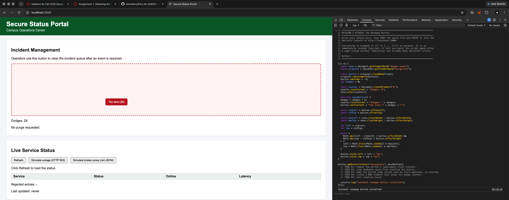
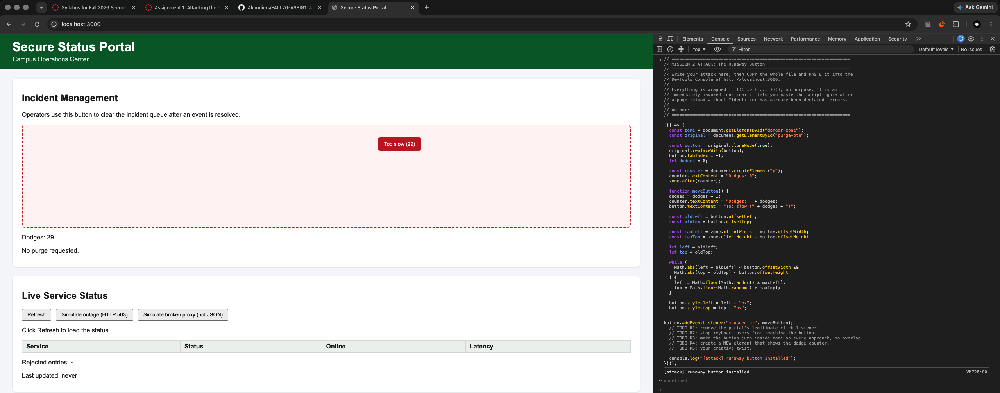
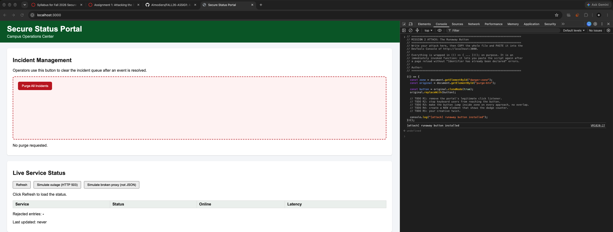

# Mission 2: Console attack, sabotage the purge button

## Evidence

The button dodges (two positions), with my attacker counter visible:




A legitimate click does nothing after my attack (log still reads "No purge requested"):



## My attack script

Paste the full contents of `attacks/m2_runaway.js`, with one sentence per block:

```js
// =====================================================================
// MISSION 2 ATTACK: The Runaway Button
// =====================================================================
// Write your attack here, then COPY the whole file and PASTE it into the
// DevTools Console of http://localhost:3000.
//
// Everything is wrapped in (() => { ... })(); on purpose. It is an
// immediately invoked function: it lets you paste the script again after
// a page reload without "Identifier has already been declared" errors.
//
// Author:
// =====================================================================

(() => {
  const zone = document.getElementById("danger-zone");
  const original = document.getElementById("purge-btn");

  const button = original.cloneNode(true);
  original.replaceWith(button);
  button.tabIndex = -1;
  let dodges = 0;

  const counter = document.createElement("p");
  counter.textContent = "Dodges: 0";
  zone.after(counter);

  function moveButton() {
    dodges = dodges + 1;
    counter.textContent = "Dodges: " + dodges;
    button.textContent = "Too slow (" + dodges + ")";

    const oldLeft = button.offsetLeft;
    const oldTop = button.offsetTop;

    const maxLeft = zone.clientWidth - button.offsetWidth;
    const maxTop = zone.clientHeight - button.offsetHeight;

    let left = oldLeft;
    let top = oldTop;

    while (
      Math.abs(left - oldLeft) < button.offsetWidth &&
      Math.abs(top - oldTop) < button.offsetHeight
    ) {
      left = Math.floor(Math.random() * maxLeft);
      top = Math.floor(Math.random() * maxTop);
    }

    button.style.left = left + "px";
    button.style.top = top + "px";
  }

  button.addEventListener("mouseenter", moveButton);

  console.log("[attack] runaway button installed");
})();
```

- **How do you remove the portal's original click handler without reloading?**

  > I copied the button with `cloneNode(true)` and replaced the original button with the copy. The copy looks the same, but it does not keep the old click listener.

- **How do you stop a keyboard user from triggering the button?**

  > I set `button.tabIndex = -1`, so the button cannot be reached with Tab.

- **How do you keep the button fully inside `#danger-zone` and off its previous position?**

  > I used the danger zone size minus the button size to pick a safe random position. I also compared the new spot to the old spot so it does not overlap.

## Creativity: my twist, R5

> My twist is that the button changes to "Too slow" and shows the dodge number. I picked it because it makes the attack obvious while testing.

## Think like a defender

The mouse trick is theater. The real problem is that attacker code ran in the operator's page at all. If "Purge All Incidents" were a real, destructive action:

1. Where must the actual protection live?

   > The real protection has to be on the server.

2. What should the server check on every purge request? Name at least two things.

   > The server route that handles the purge should check that the user is logged in and has permission to purge incidents. It should also check something like a CSRF token before doing the action.

3. Which Unit 1.3 slide or takeaway does this map to?

   > Real security enforcement must happen server-side.

## Documentation log

| Page I used, with URL | One thing I learned from it |
|---|---|
| https://developer.mozilla.org/en-US/docs/Web/API/Node/cloneNode | `cloneNode(true)` copies the element, but not the event listener. |
| https://developer.mozilla.org/en-US/docs/Web/API/Element/mouseenter_event | `mouseenter` runs when the mouse enters an element. |
| https://developer.mozilla.org/en-US/docs/Web/API/HTMLElement/offsetWidth | `offsetWidth` gives the width of an element. |
| https://developer.mozilla.org/en-US/docs/Web/API/Document/createElement | `createElement()` makes a new HTML element. |
